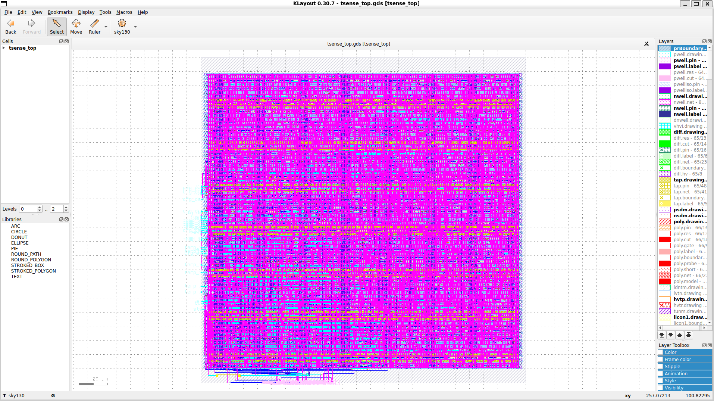
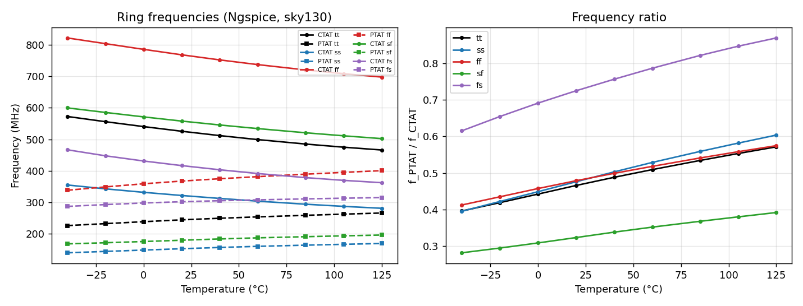
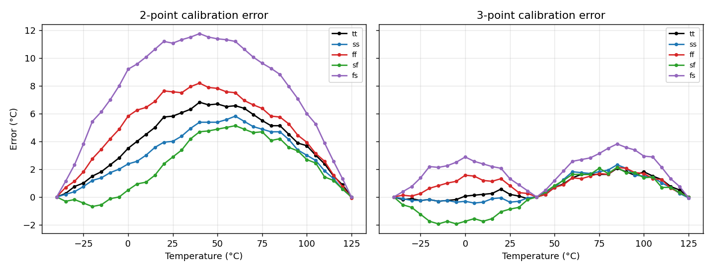

# Synthesizable Dual Ring-Oscillator Temperature Sensor (SkyWater 130 nm)

An on-chip temperature sensor built only from digital standard cells, taken from transistor-level characterization in Ngspice through Verilog RTL to a DRC- and LVS-clean GDSII layout with the open-source LibreLane flow.



## The idea

A ring oscillator's frequency depends on gate delay, and gate delay depends on temperature, so counting oscillator cycles gives a temperature reading. Two problems had to be solved:

1. **Plain inverter rings barely react to temperature in sky130 at 1.8 V.** Falling mobility (slower) and falling threshold voltage (faster) almost cancel. Stacking four transistors changes this balance:
   - **CTAT ring:** 10 × NAND4 (stacked NMOS) gets **slower** as temperature rises.
   - **PTAT ring:** 10 × NOR4 (stacked PMOS) gets **faster** as temperature rises.
2. **A single ring is dominated by process variation.** A slow chip slows both rings, so the design measures the **ratio** of the two frequencies. Process effects largely cancel, while temperature pushes the two rings in opposite directions.

Each ring starts with a NAND2 enable gate, so both oscillators are off when no measurement is running.

## Architecture

| Block | File | Notes |
|---|---|---|
| CTAT and PTAT oscillators | `tsense_ro_ctat.v`, `tsense_ro_ptat.v` | Standard-cell rings, protected from optimization during place and route |
| Ripple counters | `tsense_ripple_cnt.v` | Only the first flip-flop sees the full ring frequency, so no clock tree is needed |
| 2-flop synchronizers | `tsense_sync2.v` | Safe crossing between the two ring clocks and the 10 MHz reference clock |
| Control FSM and calibration | `tsense_core.v` | IDLE → EN → RUN → SETTLE → CAP → CALC, with a timeout error flag |
| Top level and registers | `tsense_top.v` | Calibration registers and output |

**Measurement:** The PTAT ring is counted during 4096 (2¹²) CTAT cycles, so `raw = 4096 × f_PTAT / f_CTAT`.

**Calibration:** 2-point (linear) or 3-point (piecewise-linear) conversion from `raw` to temperature, using fixed-point arithmetic (slope in Q0.16, output in 1/16 °C).

## Simulation results

**Ring oscillators (Ngspice, sky130, 1.8 V, -40 to 125 °C, 5 process corners)**



- In the tt corner, the CTAT ring falls from 572 to 466 MHz and the PTAT ring rises from 227 to 266 MHz, so the ratio rises by about 44%.
- At -40 °C, the raw CTAT frequency ranges from 355 MHz (ss) to 821 MHz (ff), roughly ±40% around tt. The ratio stays between 0.395 and 0.412 across tt, ss and ff, so process variation largely cancels.
- In the skewed corners (sf and fs), NMOS and PMOS move in opposite directions and the ratio does not cancel (0.28 vs 0.62), which is why each chip needs calibration.

**Full sensor with calibration (Verilog testbench, behavioral rings from the Ngspice data)**



| Corner | Worst-case error, 2-point | Worst-case error, 3-point |
|---|---|---|
| tt | 6.8 °C | 2.1 °C |
| ss | 5.8 °C | 2.3 °C |
| ff | 8.2 °C | 2.1 °C |
| sf | 5.1 °C | 2.1 °C |
| fs | 11.8 °C | 3.8 °C |

Adding a third calibration point at 40 °C cuts the worst-case error across all corners from 11.8 °C to 3.8 °C. All error figures are from simulation; the chip has not been fabricated.

Raw data: [`results/ro_freq.csv`](results/ro_freq.csv) and `results/tb_results_<corner>.csv`.

## Layout results (LibreLane, sky130_fd_sc_hd)

| Metric | Value |
|---|---|
| Die size | 230 × 230 µm |
| Standard cells (excluding fill and tap) | 3,587 |
| Flip-flops | 187 |
| Standard-cell area | 33,453 µm² |
| Utilization | 73.9% |
| Reference clock | 10 MHz, no setup or hold violations |
| DRC (Magic and KLayout) | 0 errors |
| LVS (Netgen) | Passed |
| Antenna | Passed |

Full numbers are in [`results/metrics.csv`](results/metrics.csv) and the sign-off log extract is in [`results/signoff_summary.txt`](results/signoff_summary.txt). The final layout is [`results/tsense_top.gds`](results/tsense_top.gds).

**Note on slew warnings:** The flow reports max-slew warnings on the oscillator nets. This is expected: the oscillator cells are deliberately marked "don't touch" so the tools can't add buffers that would change their frequency.

## Repository structure

```
analog/     Ngspice characterization of both rings (5 process corners, -40 to 125 °C)
rtl/        Verilog design
tb/         Behavioral ring models (from the Ngspice data) and full-sensor testbench
librelane/  LibreLane configuration for RTL-to-GDSII
results/    Simulation data and plots, layout screenshot, GDSII, metrics and sign-off summary
```

## How to run

Tools: Ngspice, Icarus Verilog, GTKWave, LibreLane and the SkyWater sky130A PDK.

```bash
# 1. Characterize the oscillators (writes tb/ro_table_<corner>.vh)
cd analog && ./run_analog.sh

# 2. Simulate the full sensor with 2-point and 3-point calibration
cd ../tb && ./run_sim.sh

# 3. RTL to GDSII
cd ../librelane && librelane config.yaml
```

## Author

P Mrudula, B.E. Electronics and Communication Engineering, RNS Institute of Technology, Bengaluru
